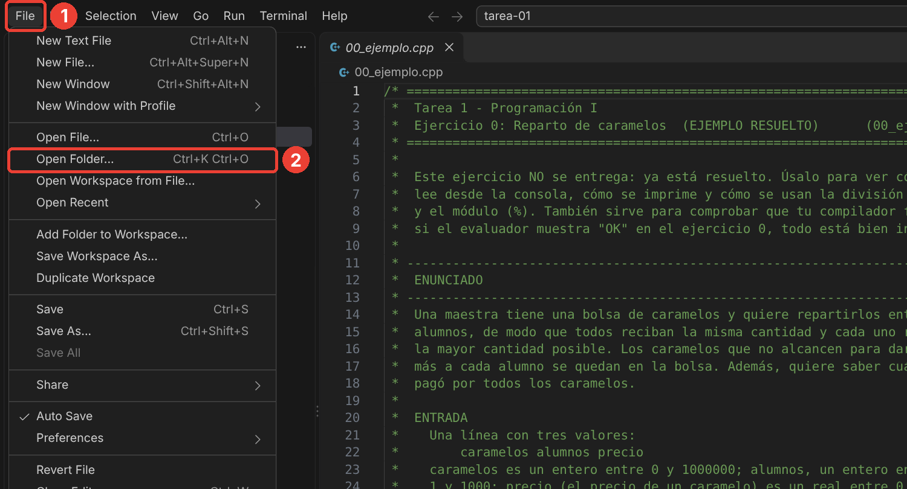
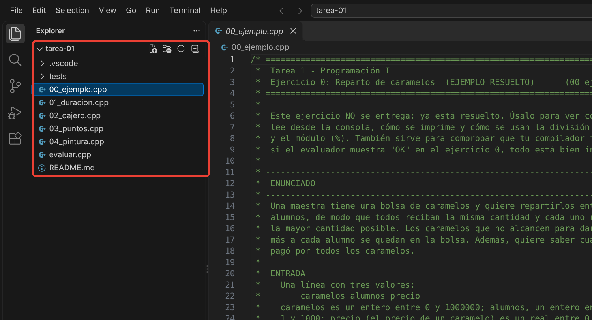
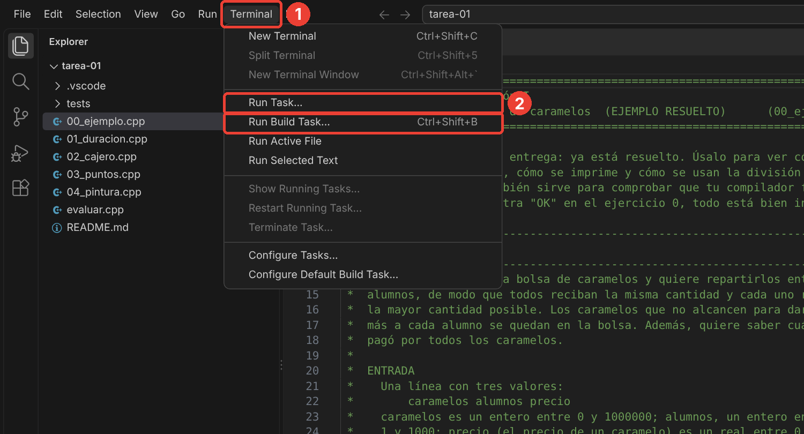
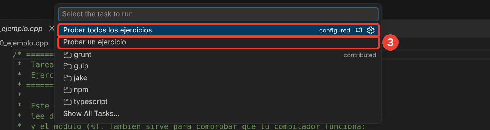
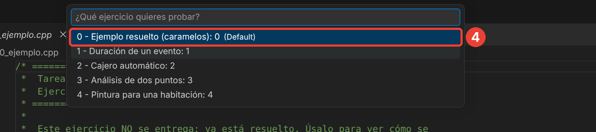
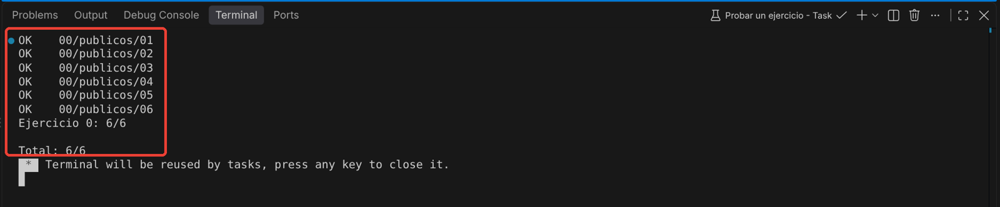
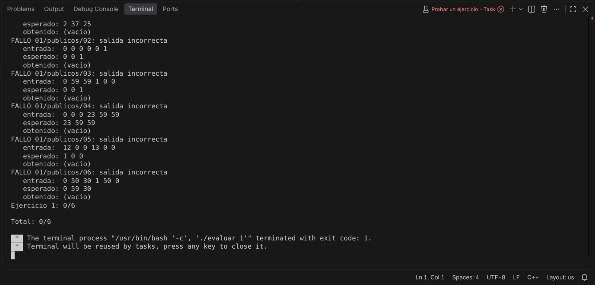

# Tarea 1 — Programación I

Resolver cuatro problemas en C++ usando tipos de datos, variables, entrada/salida, operadores, expresiones y funciones estándar. Cada ejercicio es un programa independiente.

## Instrucciones

- Completa los archivos `01_duracion.cpp`, `02_cajero.cpp`, `03_puntos.cpp` y `04_pintura.cpp`. Conserva sus nombres. Cada archivo incluye su enunciado y comentarios que guían los pasos a seguir.
- Usa `std::cin` y `std::cout`. No imprimas preguntas, etiquetas, unidades ni explicaciones.
- No uses condicionales (`if`, `switch`, `?:`), ciclos, arreglos ni funciones propias. Puedes usar funciones estándar de `<cmath>`.
- Las entradas siempre cumplen las restricciones. No debes validarlas.
- Usa `double` para cantidades reales. Puedes imprimir seis o más decimales con `<iomanip>` y `std::fixed << std::setprecision(6)`.
- El evaluador ignora diferencias de espacios y saltos de línea, pero exige la cantidad y el orden de valores indicados. Los resultados enteros deben ser exactos. Para resultados reales acepta un error absoluto de hasta `0.00001` o relativo de hasta `0.000001`.
- Entrega los cuatro archivos `.cpp`. Debes poder explicar y modificar tu solución. Realiza el trabajo por tu cuenta, sin generadores de código con IA.

## 0. Ejemplo resuelto: reparto de caramelos

Archivo: `00_ejemplo.cpp`. **Este ejercicio ya está resuelto y no se entrega.**

Léelo antes de empezar: muestra, con comentarios paso a paso, cómo declarar variables `int` y `double`, cómo leer datos con `std::cin`, cómo imprimir resultados con `std::cout`, y cómo funcionan la división entera (`/`) y el módulo (`%`). También sirve para comprobar que el compilador está bien instalado: si el evaluador muestra `OK` en el ejercicio 0, todo funciona.

Una maestra reparte caramelos entre sus alumnos de modo que todos reciban la misma cantidad, la mayor posible. Los que sobran se quedan en la bolsa. Además, quiere saber cuánto pagó por todos los caramelos.

### Entrada

Una línea con `caramelos alumnos precio`. `caramelos` es un entero entre 0 y 1000000; `alumnos`, un entero entre 1 y 1000; `precio`, el precio de un caramelo, es un real entre 0 y 100.

### Salida

Tres valores: `porAlumno sobrantes costoTotal`. Los dos primeros son enteros; `costoTotal` es real.

### Ejemplo

Entrada:
```text
17 5 0.25
```
Salida:
```text
3 2 4.250000
```

17 / 5 da 3 (división entera) y 17 % 5 da 2 (el resto). El costo es 17 × 0.25 = 4.25.

## 1. Duración de un evento

Archivo: `01_duracion.cpp`.

Un evento comienza y termina el mismo día. Calcula su duración en horas, minutos y segundos. La hora final es estrictamente posterior a la inicial.

### Entrada

Dos líneas con tres enteros cada una: `horaInicio minutoInicio segundoInicio` y `horaFin minutoFin segundoFin`. Las horas están entre 0 y 23; minutos y segundos, entre 0 y 59.

### Salida

Tres enteros: `horas minutos segundos` de duración. Los minutos y segundos del resultado deben estar entre 0 y 59.

### Ejemplo

Entrada:
```text
14 35 20
17 12 45
```
Salida:
```text
2 37 25
```

## 2. Cajero automático

Archivo: `02_cajero.cpp`.

Un cajero dispone de suficientes billetes de 100, 50, 20, 10, 5 y 1 unidades monetarias. Determina cómo entregar un monto usando la menor cantidad total de billetes.

### Entrada

Un entero `monto`, entre 0 y 1000000.

### Salida

Seis enteros: cantidades de billetes de 100, 50, 20, 10, 5 y 1, en ese orden. Incluye las cantidades que sean cero.

### Ejemplo

Entrada:
```text
286
```
Salida:
```text
2 1 1 1 1 1
```

## 3. Análisis de dos puntos

Archivo: `03_puntos.cpp`.

Dados dos puntos del plano, calcula su distancia y las coordenadas del punto medio.

### Entrada

Dos líneas: `x1 y1` y `x2 y2`. Todas las coordenadas son reales entre -1000 y 1000. Los puntos pueden coincidir.

### Salida

Tres números reales: `distancia xMedio yMedio`, en ese orden.

Puedes usar estas relaciones matemáticas:

- Distancia: raíz cuadrada de `(x2 - x1)² + (y2 - y1)²`.
- Coordenada x del punto medio: `(x1 + x2) / 2`.
- Coordenada y del punto medio: `(y1 + y2) / 2`.

### Ejemplo

Entrada:
```text
1 2
5 5
```
Salida:
```text
5.000000 3.000000 3.500000
```

## 4. Pintura necesaria para una habitación

Archivo: `04_pintura.cpp`.

Una habitación rectangular necesita pintura en sus cuatro paredes. No se pintan el piso, el techo ni las puertas y ventanas. Calcula la superficie total de las paredes, la superficie que debe pintarse, los litros necesarios y la cantidad mínima de latas que se deben comprar. Las latas solo se venden completas; no se añade un margen por desperdicio ni una segunda capa.

### Entrada

```text
largo ancho alto
areaAberturas
rendimiento
litrosPorLata
```

Todos los datos son reales. Las dimensiones están entre 1 y 100 metros. `areaAberturas` es el área total de puertas y ventanas en m², entre cero y la superficie total de las cuatro paredes, inclusive. `rendimiento` está entre 1 y 100 m² por litro; `litrosPorLata`, entre 1 y 20 litros.

### Salida

Cuatro valores, en este orden: `areaParedes areaPintable litrosNecesarios latas`. Los tres primeros son reales; `latas` es un entero. Si la superficie pintable es cero, se necesitan cero litros y cero latas.

### Ejemplo

Entrada:
```text
5 4 3
4
10
4
```
Salida:
```text
54.000000 50.000000 5.000000 2
```

### Ayuda

**El ejemplo, paso a paso.** La habitación mide 5 × 4 metros de piso y 3 metros de alto. Vista desde arriba es un rectángulo: tiene dos paredes de 5 m de base y dos de 4 m, todas de 3 m de alto.

- Paredes: dos de 5 × 3 = 15 m² y dos de 4 × 3 = 12 m². En total, 15 + 15 + 12 + 12 = **54** m².
- Superficie pintable: se restan los 4 m² de puertas y ventanas: 54 − 4 = **50** m².
- Litros: cada litro pinta 10 m², así que se necesitan 50 / 10 = **5** litros.
- Latas: cada lata trae 4 litros. 5 / 4 = 1.25 latas, pero no se puede comprar un cuarto de lata: hay que comprar **2**.

Calcula primero a mano un caso, como este, y después escribe el programa.

**Bibliotecas.** Este ejercicio necesita tres. Cada `#include` va al principio del archivo y da acceso a un grupo de funciones:

```cpp
#include <iostream>   // std::cin y std::cout
#include <cmath>      // std::ceil, std::sqrt, std::pow...
#include <iomanip>    // std::fixed y std::setprecision
```

**Leer varios datos.** No importa que vengan en líneas distintas: `std::cin` los toma en orden.

```cpp
double a, b, c, d;
std::cin >> a >> b >> c >> d;   // sirve para "1 2 3 4" o para un dato por línea
```

**Redondear hacia arriba con `std::ceil`.** Por ejemplo, para saber cuántos autobuses de 40 puestos se necesitan para 130 estudiantes (no se pueden pedir 3.25 autobuses):

```cpp
double estudiantes = 130;
double puestosPorBus = 40;
double busesExactos = estudiantes / puestosPorBus;   // 3.25
double busesReal = std::ceil(busesExactos);          // 4.0
```

`std::ceil` deja igual un número que ya es entero: `std::ceil(2.0)` da 2 y `std::ceil(0.0)` da 0. Por eso, si no hay nada que pintar, el resultado es 0 latas sin necesidad de un `if`.

**Convertir a entero con `static_cast<int>`.** `std::ceil` devuelve un `double`, y con `std::fixed << std::setprecision(6)` se imprimiría como `4.000000`. Para que salga `4`, conviértelo a `int`:

```cpp
int buses = static_cast<int>(busesReal);   // 4

std::cout << std::fixed << std::setprecision(6);
std::cout << busesReal << "\n";   // imprime 4.000000  (incorrecto para latas)
std::cout << buses << "\n";       // imprime 4         (correcto)
```

Cuidado con el orden: primero se redondea y después se convierte. `static_cast<int>` por sí solo **corta** los decimales, no redondea:

```cpp
static_cast<int>(3.25)              // da 3: ¡faltaría un bus!
static_cast<int>(std::ceil(3.25))   // da 4
```

## Ejecutar las pruebas públicas

Solo se necesita VS Code y un compilador de C++17; no hace falta Python ni otro programa. Si todavía no los tienes, sigue primero la **guía de instalación** (`SETUP.pdf`), que explica paso a paso cómo instalar todo en Windows y en macOS.

- **Windows:** descomprime el compilador portátil `w64devkit` dentro de la carpeta de la tarea, de modo que exista la carpeta `w64devkit/bin`.
- **macOS:** instala las herramientas de desarrollo de Apple con `xcode-select --install`.

### Opción 1: desde VS Code (recomendada)

Las capturas muestran VS Code en inglés, que es como viene instalado. Si tu VS Code está en español, los menús se llaman igual pero traducidos: se indican entre paréntesis.

**Paso 1. Abre la carpeta de la tarea.** Ve a **File > Open Folder…** (*Archivo > Abrir carpeta…*) y elige la carpeta `tarea-01`, la que contiene este README. Abre la carpeta completa, no un archivo suelto: si no, VS Code no encuentra la configuración de las pruebas.



A la izquierda, en el panel **Explorer** (*Explorador*), deberías ver los archivos de la tarea y la carpeta `.vscode`:



**Paso 2. Abre el menú de tareas.** Ve a **Terminal > Run Task…** (*Terminal > Ejecutar tarea…*).



**Paso 3. Elige qué probar.** Aparece una lista arriba, en el centro de la ventana. Elige **Probar un ejercicio**, o **Probar todos los ejercicios** para correrlos todos a la vez. Ignora las demás opciones (grunt, gulp, npm…): vienen con VS Code y no se usan en esta tarea.



**Paso 4. Elige el número del ejercicio.** La primera vez, elige el **0**: es el ejemplo resuelto y sirve para comprobar que todo está bien instalado.



**Paso 5. Lee el resultado.** Se abre la terminal en la parte de abajo. Si todo está bien instalado, el ejercicio 0 muestra `OK` en sus seis casos y `Total: 6/6`:



Cuando un ejercicio todavía no está resuelto, o tiene un error, cada caso aparece como `FALLO` junto con la entrada, la salida esperada y la que produjo tu programa. Así se ve el ejercicio 1 con la plantilla vacía, que todavía no imprime nada:



Para cerrar el resultado, presiona cualquier tecla en la terminal.

**Atajo:** `Ctrl+Shift+B` (`Cmd+Shift+B` en macOS) prueba todos los ejercicios directamente, sin pasar por los menús. Equivale a **Terminal > Run Build Task…** (*Terminal > Ejecutar tarea de compilación…*).

### Opción 2: desde la terminal

Desde la carpeta de la tarea, compila el evaluador una sola vez:

```sh
g++ -std=c++17 -O2 evaluar.cpp -o evaluar
```

Luego ejecútalo. Empieza por el ejercicio 0 para comprobar que todo funciona:

```sh
./evaluar 0        # macOS: solo el ejemplo resuelto
./evaluar          # macOS: todos los ejercicios
./evaluar 3        # macOS: solo el ejercicio 3
.\evaluar.exe 0    # Windows: solo el ejemplo resuelto
.\evaluar.exe      # Windows: todos los ejercicios
.\evaluar.exe 3    # Windows: solo el ejercicio 3
```

Si la terminal no encuentra `g++`, indica la ruta del compilador:

```sh
.\evaluar.exe --compilador "w64devkit/bin/g++.exe"
```

### Cómo leer el resultado

Cada caso se muestra como `OK` o `FALLO`. Cuando la salida es incorrecta, el evaluador muestra la entrada, la salida esperada y la que produjo tu programa. Al final aparece el total de casos aprobados. La cantidad de decimales no importa: `4.25`, `4.250000` y `4.250000000000` se consideran iguales. Las plantillas vacías compilan, pero fallarán hasta que implementes cada solución. Superar las pruebas públicas no garantiza superar todas las pruebas de evaluación.
