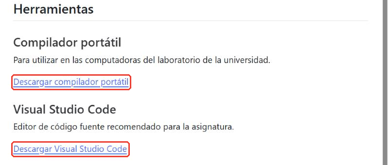
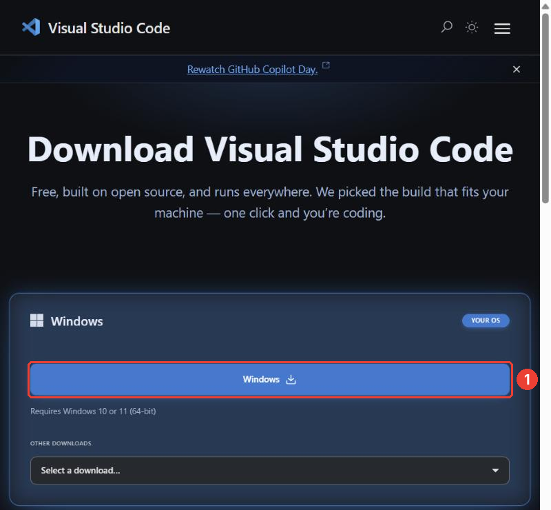
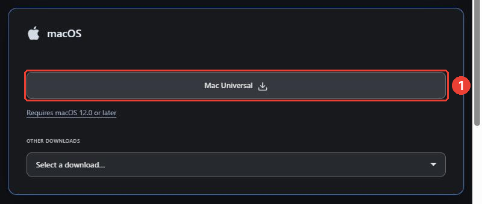
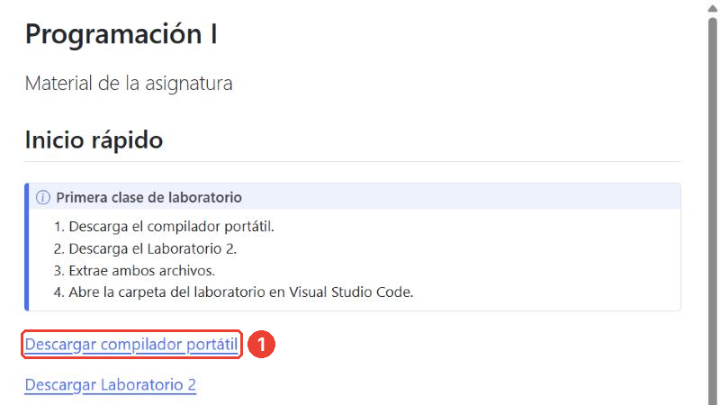
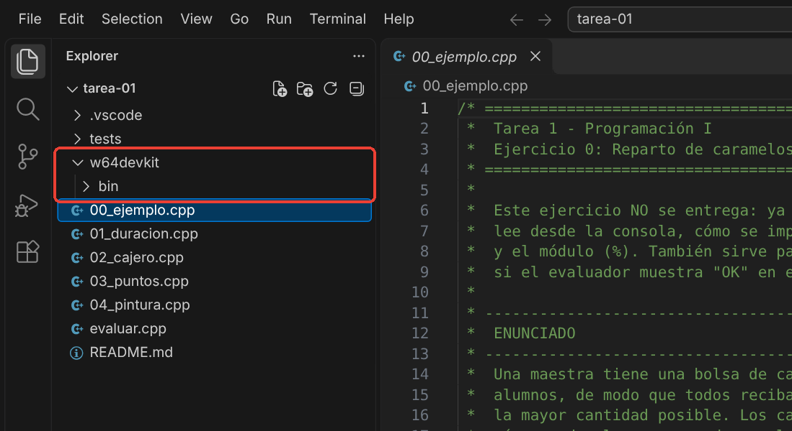
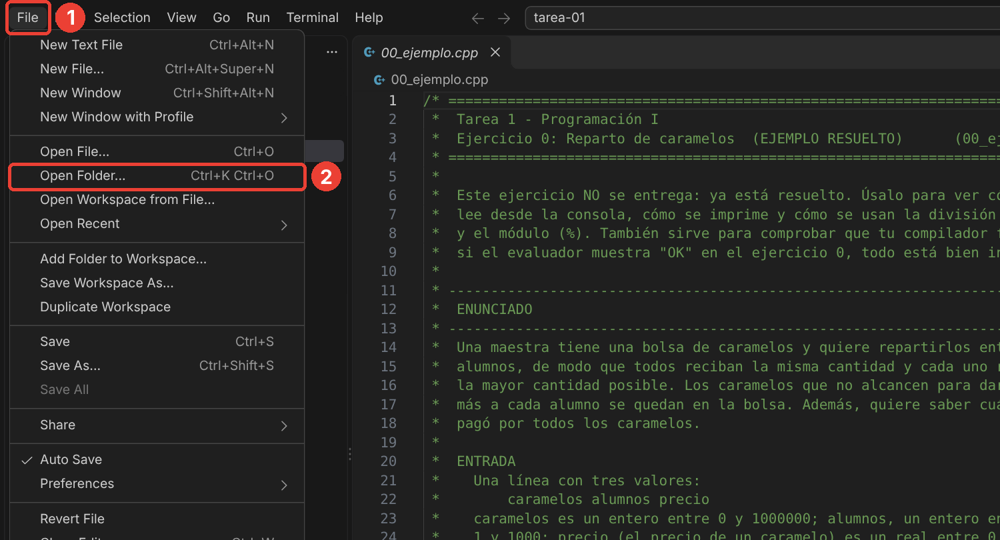
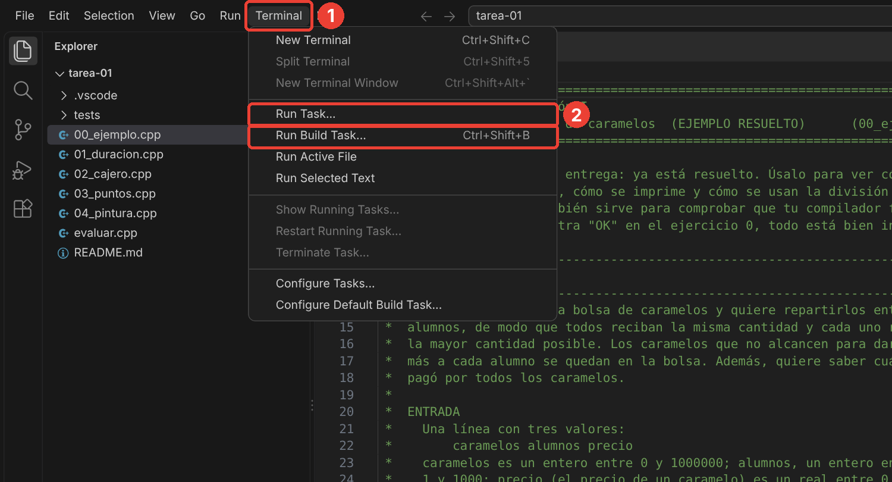
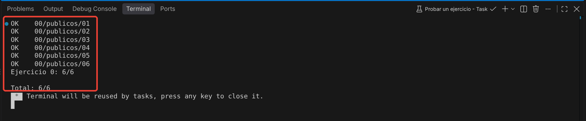

# Guía de instalación — Programación I

Para hacer las tareas necesitas dos programas:

- **Visual Studio Code (VS Code):** el editor donde escribes el código.
- **Un compilador de C++:** el programa que convierte tu código en un programa que se puede ejecutar. En Windows usarás el compilador portátil **w64devkit**; en macOS, las herramientas de desarrollo de Apple.

Todo es gratuito y toma unos 15 minutos. Hazlo apenas recibas la tarea, no el día de la entrega: si algo falla, tendrás tiempo para preguntar.

## Parte 1. Instalar Visual Studio Code

Entra a la página del curso, **uru.tomassantana.com/p1**, y baja hasta la sección **Herramientas**. Haz clic en **Descargar Visual Studio Code**. También puedes ir directamente a **code.visualstudio.com/download**.



### En Windows

**Paso 1.** La página detecta tu sistema operativo y muestra primero el tuyo. En Windows, haz clic en el botón azul **Windows**. Se descarga un instalador llamado parecido a `VSCodeUserSetup-x64-….exe`.



**Paso 2.** Abre el archivo descargado (en la carpeta **Descargas**).

**Paso 3.** Acepta el acuerdo de licencia y pulsa **Siguiente** en cada pantalla. En **Tareas adicionales**, deja marcada la opción **Agregar a PATH**. Te conviene marcar también **Agregar la acción "Abrir con Code" al menú contextual de directorio**: así podrás abrir la carpeta de una tarea con clic derecho.

**Paso 4.** Pulsa **Instalar** y, al terminar, **Finalizar**.

### En macOS

**Paso 1.** La página de descarga detecta tu sistema operativo y muestra primero el tuyo. En una Mac, el primer recuadro será **macOS**: haz clic en su botón **Mac Universal**, que funciona tanto en las Mac con procesador Intel como en las de Apple (M1, M2…). Se descarga un archivo `.dmg`.



La captura se tomó desde Windows, por eso el recuadro de macOS aparece como segunda opción y con el botón gris. En tu Mac estará arriba y con el botón azul, pero es el mismo botón.

**Paso 2.** Abre el archivo `.dmg` descargado (en la carpeta **Descargas**). Se abre una ventana con el ícono de **Visual Studio Code**.

**Paso 3.** Arrastra **Visual Studio Code** a la carpeta **Aplicaciones**.

**Paso 4.** Abre VS Code desde **Aplicaciones** con doble clic. Si macOS pregunta si quieres abrir una aplicación descargada de Internet, pulsa **Abrir**. Si VS Code pide acceso a tu calendario, contactos o fotos, pulsa **No permitir**: no lo necesita.

Si quieres tenerlo a mano, haz clic derecho (o Control + clic) en su ícono del Dock y elige **Opciones > Mantener en el Dock**.

## Parte 2. Instalar el compilador

### En Windows: compilador portátil (w64devkit)

El compilador portátil no se instala: es una carpeta que se coloca **dentro de la carpeta de la tarea**. VS Code ya está configurado para buscarlo ahí.

**Paso 1.** Descarga y descomprime la carpeta de la tarea, por ejemplo `tarea-01`.

**Paso 2.** En la página del curso, **uru.tomassantana.com/p1**, haz clic en **Descargar compilador portátil**. Se descarga el archivo `w64devkit-x64-2.10.0.7z.exe`.



**Paso 3.** Mueve ese archivo **a la carpeta de la tarea**, junto a `README.md` y los archivos `.cpp`.

**Paso 4.** Haz doble clic en el archivo. Es un archivo autoextraíble: se abre una pequeña ventana que pregunta dónde extraer. Deja la carpeta que propone (la de la tarea) y pulsa **Extract**.

Si Windows muestra el aviso **"Windows protegió su PC"**, pulsa **Más información** y luego **Ejecutar de todas formas**. Hazlo solo con el archivo descargado desde la página del curso.

**Paso 5.** Al terminar aparece una carpeta nueva llamada `w64devkit`. Ya puedes borrar el archivo `.exe`.

La carpeta de la tarea debe quedar así, con `w64devkit` al mismo nivel que los ejercicios y con la carpeta `bin` dentro de `w64devkit`:



Revisa que no haya quedado una carpeta dentro de otra, como `w64devkit/w64devkit/bin`: en ese caso, VS Code no encontrará el compilador.

**Para las próximas tareas:** cada tarea necesita su propia copia de `w64devkit` adentro. Copia la carpeta `w64devkit` de una tarea a la siguiente: no hace falta volver a descargarla.

### En macOS: herramientas de desarrollo de Apple

**Paso 1.** Abre la aplicación **Terminal**: pulsa `Cmd+Espacio`, escribe `Terminal` y pulsa `Enter`.

**Paso 2.** Escribe el siguiente comando y pulsa `Enter`:

```sh
xcode-select --install
```

**Paso 3.** Aparece una ventana que pregunta si quieres instalar las herramientas. Pulsa **Instalar** y acepta la licencia. La descarga puede tardar varios minutos.

Si la Terminal responde que las herramientas ya están instaladas (*command line tools are already installed*), no tienes que hacer nada más.

**Paso 4.** Cuando termine, comprueba la instalación escribiendo:

```sh
g++ --version
```

Debe aparecer un texto que empieza con **Apple clang version**. En macOS, `g++` es otro nombre del compilador de Apple, y sirve igual para el curso.

## Parte 3. Comprobar que todo funciona

**Paso 1.** Abre VS Code y ve a **File > Open Folder…** (*Archivo > Abrir carpeta…*). Elige la carpeta **de la tarea** (no un archivo suelto ni la carpeta Descargas completa).



**Paso 2.** Ve a **Terminal > Run Task…** (*Terminal > Ejecutar tarea…*), elige **Probar un ejercicio** y luego el **0**.



**Paso 3.** En la terminal, en la parte de abajo, deberías ver `OK` en los seis casos y `Total: 6/6`. Si es así, todo está listo para empezar la tarea.



El README de cada tarea explica con más detalle cómo probar los ejercicios.

## Problemas frecuentes

**"No se encontró el compilador g++" (Windows).** VS Code no encuentra la carpeta `w64devkit`. Revisa que:

- `w64devkit` esté **dentro** de la carpeta de la tarea, y que dentro esté `bin` (no `w64devkit/w64devkit/bin`);
- hayas abierto en VS Code la carpeta de la tarea, la que contiene `w64devkit`, `.vscode` y los ejercicios.

**"No se encontró el compilador g++" o "xcrun: error: invalid active developer path" (macOS).** Las herramientas de Apple no están instaladas, o una actualización de macOS las desinstaló. Vuelve a ejecutar `xcode-select --install`.

**No aparecen las tareas "Probar un ejercicio" ni "Probar todos los ejercicios".** Abriste un archivo suelto en lugar de la carpeta. Usa **File > Open Folder…** y elige la carpeta de la tarea.

**No se ve la carpeta `.vscode`.** Windows y macOS ocultan las carpetas cuyo nombre empieza con un punto, pero VS Code sí las muestra en el panel **Explorer**. Si no aparece ahí, la carpeta de la tarea no se descomprimió completa: vuelve a descomprimirla.
